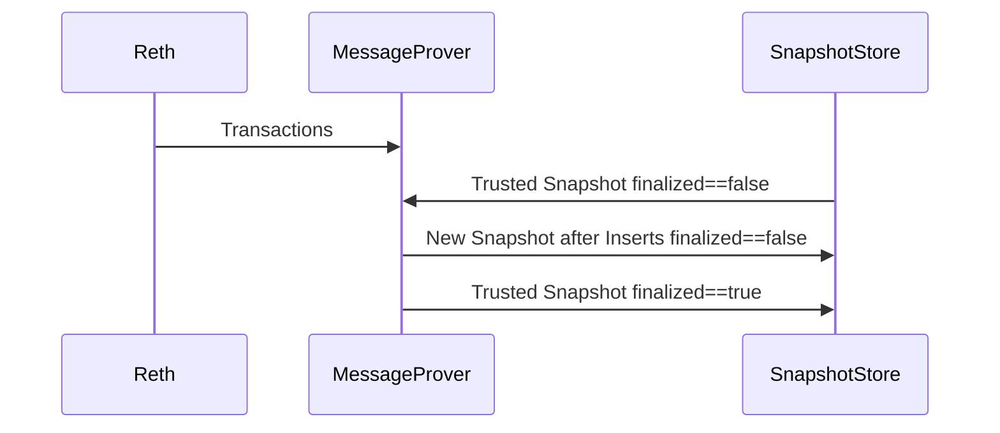

# Overview
The `ev-prover` service is a simple gRPC service designed to serve ZK proofs to clients.
It encapsulates the SP1 programs maintained under `sp1`, and uses the `sp1_sdk::ProverClient` in order to interface with them.

## Running the ev-prover service for a private or public testnet
The default mode (batch) aggregates a range of blocks and proves them in one go, using a single GPU instance.

### Setup
1. Start the docker network locally and wait for `hyperlane-init` to finish (`docker logs -f hyperlane-init`)
    ```shell
    make start
    ```

2. Export the addresses `hyperlane-init` generated; `ev-prover init` and the make targets read them from the environment
    ```shell
    set -a
    source testnet/hyperlane/generated/deployed.env
    set +a
    ```

Run the following commands from the root of the repository.

1. Install the binary to Cargo binary directory ~/.cargo/bin
    ```shell
    cargo install --locked --path ./crates/ev-prover
    ```

2. Initialize a new `ev-prover` home directory and configuration file from the environment (delete `~/.ev-prover/config/config.yaml` to regenerate it after a new testnet run):
    ```shell
    ev-prover init
    ```

3. Deploy the ZKISM
    ```shell
    make deploy-ism
    ```

4. Update the ISM used by Hyperlane to the new ZKISM
    ```shell
    make update-ism
    ```

5. (Optional) If you have authentication enabled on your Celestia node, you need to set the auth token in the config file.

   First, retrieve your auth token:
    ```shell
    celestia bridge auth read
    # Or if using docker:
    # docker compose exec celestia-bridge celestia bridge auth read
    ```

   Then, edit `~/.ev-prover/config/config.yaml` and add the `celestia_auth_token` field under `rpc`:
    ```yaml
    rpc:
      celestia_rpc: "http://localhost:26658"
      celestia_auth_token: YOUR_AUTH_TOKEN_HERE
      evnode_rpc: "http://localhost:7331"
      evreth_rpc: "http://localhost:8545"
    ```

6. Start the `ev-prover` application binary using:

    ```shell
    RUST_LOG="ev_prover=debug" ev-prover start
    ```

The service will join the tasks in `src/prover/programs/batch.rs` and `src/prover/programs/message.rs`.

## Build system

This crate contains a custom `build.rs` that builds the SP1 programs used for proof generation.

## Protobuf

Protobuf is used as the canonical encoding format for gRPC messaging. The Protobuf definitions for the prover service are included in this crate under the `proto` directory.

The `buf` toolchain is employed to handle Rust code generation.
Please refer to the [official installation documentation](https://buf.build/docs/cli/installation/) to get setup with the `buf` CLI.

Rust code-gen is produced from the Protobuf definitions via `buf.gen.yaml` plugins and included in this crate under `src/proto`.

#### Regenerating Protobuf code

When making changes to the Protobuf definitions in `proto/prover/v1/prover.proto`, regenerate the Rust code by running:

```bash
cd crates/ev-prover/proto
buf generate
```

This will generate the prost message types and tonic server/client stubs compatible with prost 0.12 and tonic 0.10.

### Protobuf development

To update the Protobuf dependencies:

```bash
cd crates/ev-prover/proto
buf dep update
```

To lint the Protobuf definitions:

```bash
cd crates/ev-prover/proto
buf lint
```

## Hyperlane Message Finality



Finality serves two distinct purposes. Firstly, it can be used to expose the status of message proofs to the user. However the primary purpose is such that errors can be detected when the finalization status is not updated for a snapshot. Currently this will not break the system, as new messages will be proven from the next snapshot onwards, but messages could get lost until a proper retry mechanism is implemented. 

So long as the finality status of all snapshots flips to `true` there is nothing to worry about. All snapshots, except for the most recent one, should be finalized at all times. Gaps in finalization indicate that message proof submission was unsuccessful, or that the DB corrupted post submission. 

Note that the message prover always takes the last known snapshot, which is expected to be unfinalized, but no such check is enforced and generates a proof using all messages that occurred from the height of the trusted snapshot + 1 all the way to the trusted EV height in ZKISM, aka `committed_height`.

## Hyperlane Message Retries

Under normal conditions there should always only be one unfinalized snapshot. No other than the latest snapshot may be unfinalized.
Should there be a snapshot that is not the latest and was not successfully finalized, then it is safe to assume that message submission
or proof generation for that snapshot failed. 

We currently support manual message submission retries, using the following command:
```bash
cargo run --release --features retry -p ev-hyperlane-script --bin ev-hyperlane -- --snapshot-index 0 --mailbox-id MAILBOX_ID --contract MERKLE_TREE_ADDRESS --rpc-url RETH_RPC_URL
```

Example with values:
```bash
cargo run --release --features retry -p ev-hyperlane-script --bin ev-hyperlane -- --snapshot-index 0 --mailbox-id 0x68797065726c616e650000000000000000000000000000000000000000000000 --contract 0x6007cE81D2FD7b9b7f22e71cE9896e00d6017ba8 --rpc-url http://127.0.0.1:8545
```

Assuming that there is an unfinalized snapshot at index `N` in the database and that the latest snapshot is >`N`, the correct snapshot-index to pass is `N-1`.
By default the retry will assume that the messages were successfully indexed and stored, since by default the prover service will retry if indexing fails and not 
store a new snapshot. However should the user observe that messages are missing during or after retry, manual indexing is recommended before running the retry command.
